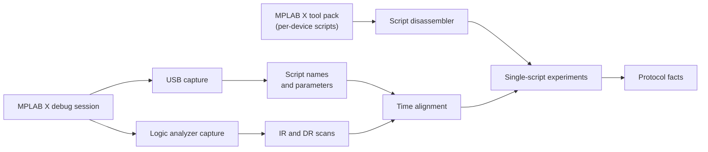

# AVR JTAG OCD research

This document tells how we got the facts of [AVR JTAG on-chip debug protocol](avr-jtag-ocd.md), and which steps went wrong.
The protocol facts are in that document. This document does not repeat them.

## Goal

Microchip does not publish the on-chip debug (OCD) protocol of the classic AVR chips with a JTAG port.
The goal was a go or no-go decision for a JTAG debug function.
The question was: can we get the protocol from a real debugger, as we did for the WCH-LinkE ([WCH-LinkE protocol](wch-link-protocol.md))?

Result: go. We know the private JTAG instructions, the OCD registers, all breakpoint types and the instruction scan.
We also know the rules for the CPU state, the software breakpoints and the flash write in debug mode.
That is enough to design the debug function.

The other AVR interfaces need no research. The datasheets describe JTAG programming, UPDI, TPI and PDI.

## Setup

[The captures README](avr-jtag-ocd-captures/README.md#setup) lists the target, the debugger, the host tools and the logic analyzer.

Wiring of the PICkit 5 to the Arduino Mega2560 board. PICkit 5 pin 1 has the ▲ mark.
ISP is the AVR in-system programming interface (SPI). ICSP is the 6-pin ISP header on the board.
The ISP pinout and the JTAG pinout of the PICkit 5 use the same pins 4 to 7.

| PICkit 5 pin | ISP (to set the fuses), ICSP header of the ATmega2560 | JTAG, silkscreen label on the Mega |
|---|---|---|
| 2 VTG | ICSP 2 | 5V |
| 3 GND | ICSP 6 | GND |
| 4 | MISO, ICSP 1 | TDO, A6 |
| 5 | SCK, ICSP 3 | TCK, A4 |
| 6 | RESET, ICSP 5 | RESET |
| 7 | MOSI, ICSP 4 | TDI, A7 |
| 8 | — | TMS, A5 |

The JTAG port of the ATmega2560 is on PF4 to PF7. The Arduino Mega board calls these pins A4 to A7.
When JTAGEN is programmed, they are not available as analog inputs.

The board came with hfuse `0xD8` (JTAGEN and OCDEN not programmed). For the tests, we wrote hfuse `0x18`.
JTAG programming erases the Arduino bootloader. Make a backup of the flash before the first JTAG session, and write it back with hfuse `0xD8` after the tests.

## Method

1. **Known capture first.** `avrdude -c pickit5_jtag` read the signature of the ATmega2560. The decoded scans showed exactly the JTAG programming flow of the datasheet. This confirmed the decoder and the channel map (`m2560-avrdude-sig-jtag.txt`).
2. **The debugger scripts.** The PICkit 5 executes small scripts that the host sends. The MPLAB X tool pack contains these scripts for each device and each function, for example `Halt_JTAG`, `SetHWBP_JTAG` and `GetCoreRegs_JTAG`. For the ATmega2560 there are 25 debug scripts. The tool pack is not part of this repository.
3. **An MPLAB X debug session.** We recorded the USB traffic (Linux usbmon) and the JTAG lines at the same time. MPLAB X sends each script inline, so the USB data gives the order of the scripts and their parameters (`m2560-mplab-session-calls.txt`). The logic analyzer gives the scans (`m2560-mplab-session-jtag.txt`). A constant time offset aligns the two files.
4. **A script disassembler.** We wrote a disassembler for the script bytecode, with an opcode table that we found from the scripts. The scripts show the OCD register numbers, the BCR bits and the instruction formats.
5. **Single-script experiments.** A small host program sent one script at a time to the PICkit 5. It read the OCD registers after each type of stop, and it tested each breakpoint mode (`m2560-ocd-experiments.txt`). The program is not in this repository, because it loads the Microchip scripts at run time.
6. **A second MPLAB X session with software breakpoints.** It showed the flash write in debug mode (`m2560-mplab-swbp-calls.txt`, `m2560-mplab-swbp-jtag.txt`). In the 38-bit instruction scans, bits 37..22 hold the AVR instruction. We disassembled these instructions with `avr-objdump`, and got the full `SPM` sequence.
7. **Checks against the program.** We compared each stop address and each register value with the disassembly of the test program.

## What went wrong

| # | Problem | Cause | Fix or lesson |
|---|---|---|---|
| 1 | The first MPLAB X debug start failed with status `0x104`, "Could not connect to OCD". | OCDEN was not programmed. MPLAB X does not set it. | Program OCDEN over JTAG. The OpenMUPP probe must tell the user about OCDEN. |
| 2 | The "Add Existing Item" dialog of MPLAB X froze. | Not confirmed. MPLAB X ran on the Java 8 of the host, not on its own runtime. | We added the source file to `nbproject/configurations.xml` by hand. |
| 3 | "Step Into" seemed to do nothing. A dialog "Software Call Stack Information Unavailable" came up. | The key for "Step Into" was F5 in that keymap, not F7. The Call Stack view shows the dialog. The empty delay loop is on one source line, so a step does not move the line. | Close the Call Stack view. Step in a function with more than one source line. |
| 4 | The USB capture stayed empty. | `/dev/usbmon*` is readable by root only. | Change the access rights after each load of the `usbmon` module. |
| 5 | The scripts of the first tool pack download did not match the USB capture. | MPLAB X used tool pack 3.0.1195. The download was 3.0.1208. | Use the scripts of the installed MPLAB X. |
| 6 | A second run of the host program lost the stopped state, and the core ran again. | The PICkit 5 releases the pins and the OCD at the end of a USB session. | One host program run is one debug session. |
| 7 | Single steps went to wrong addresses, and the core ran into erased flash. | The host program did not read the status after a stop, and its CPU write-back was not complete. | Copy the MPLAB X sequence exactly before any change. |
| 8 | An own test script stopped the PICkit 5. A USB reset did not help. | A format error: one byte was missing. The PICkit 5 read an unknown opcode. | Disconnect the PICkit 5 from USB. Build own scripts only from byte sequences of scripts that work. |
| 9 | After each reconnection, the first debug-mode script stopped the PICkit 5. We first blamed our own script. | After power-up, the PICkit 5 sets up the JTAG pins only in programming mode. The debug-mode entry does not do it in all cases. | Start each session with a short programming-mode session, as MPLAB X does. |
| 10 | Two reconnections did not help. | One reconnection was not on the USB cable of the PICkit 5: the USB device number did not change. For the next one, MPLAB X still ran. It connected to the PICkit 5, and we stopped MPLAB X during the connection. | Check the USB device number after a reconnection. Close MPLAB X before another program uses the PICkit 5. |
| 11 | A breakpoint script stopped the PICkit 5. | That script path reads download data, and we sent it as a plain command. | Read the disassembly of a script before its first use. |
| 12 | After a "recovery", all CPU write-backs were wrong. We tested two wrong theories first. | To free the script of problem 11, which waited for data, we sent 4 bytes on the data endpoint. The bytes stayed in the data buffer of the PICkit 5. After that, each script used the data of the script before it. | A write test with a known pattern (r*n* = `0x40+n`) showed the shift at once. Do this test early. Only a power cycle clears the buffer. |
| 13 | MPLAB X failed to connect: "getFirmwareInfo expected 0xAF or 0xBF received 0x0". | Each 512-byte reply of the PICkit 5 has a zero-length packet after it. The host program left the last one unread. MPLAB X read it as its first reply, and all replies after it were one step late. | Read all replies in the queue before the program releases the PICkit 5. |

General lessons:

- **First copy the reference tool exactly.** Each change to the MPLAB X sequence cost time. Make a change only after a test shows that it is safe.
- **Test a write path with a known pattern before you trust it.**
- **The PICkit 5 has state that stays after a USB reconnection:** the pin setup, the data buffer and the replies in its queue. Only a power cycle clears all of it.
- **Read the disassembly of a script before you call it.** It shows the parameter count, the data transfers and the error paths.

## Open items

See [Open questions](avr-jtag-ocd.md#open-questions). The most important item is a test with OCD revision 3 (ATmega32U4).
