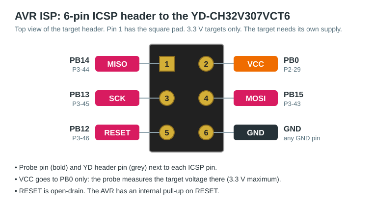

# AVR programming

The CMSIS-DAP personality can program AVR chips through the ISP (SPI) interface, debugWIRE (dW) and JTAG.
ISP programming passed a hardware test with avrdude 8.3 on the YD-CH32V307VCT6 board (see [Hardware test](#hardware-test)).
Tools that use the Microchip EDBG protocol, for example avrdude, find the probe over USB.
avrdude can also program a chip over debugWIRE, and Bloom with avr-gdb can debug it.
debugWIRE passed a hardware test on an ATtiny85 at 8 MHz and at 1 MHz (see [debugWIRE hardware test](#debugwire-hardware-test)).
avrdude can also program the classic AVR chips with a JTAG port, for example the ATmega32U4 and the ATmega2560 (see [JTAG](#jtag)).
JTAG programming passed a hardware test on an ATmega32U4 (see [JTAG hardware test](#jtag-hardware-test)).
Bloom and AVaRICE with avr-gdb can debug these chips over JTAG (see [JTAG debug with Bloom](#jtag-debug-with-bloom) and [JTAG debug with AVaRICE](#jtag-debug-with-avarice)).
JTAG debug passed a hardware test on an ATmega32U4 and an ATmega2560 (see [JTAG debug hardware test](#jtag-debug-hardware-test)).
The probe does not have the other AVR interfaces (UPDI, PDI, TPI).
[AVR JTAG on-chip debug protocol](avr-jtag-ocd.md) describes the JTAG debug protocol.

## Build

Use an image with the build option `MUPP_CMSIS_DAP_AVR`.
This option needs `MUPP_CMSIS_DAP_HID`.
Only the CH32V307 boards have the option (see [cmake.md](cmake.md)).
On these boards, both options are `ON` by default: each image with `cmsis-dap` has the AVR commands.
The protocol is in [cmsis-dap.md](cmsis-dap.md#avr-commands).

## USB ID

The probe has the USB ID `1209:0001` (the test ID of pid.codes) and the product name `OpenMUPP CMSIS-DAP`.
The product name must contain `CMSIS-DAP`, because avrdude uses it to select the packet size.

## Bloom

Bloom is a debug server for avr-gdb.
Each Bloom tool class has a fixed USB ID and a fixed HID interface number.
Bloom has no class for the ID `1209:0001`.
Until Bloom has one, use one of the two ways below.
The steps were checked against Bloom commit `9c066aa`.

### The medbg build

The build option `MUPP_AVR_USB_ID=medbg` gives the probe the ID of the Atmel Xplained Mini (`03eb:2145`).
The build also puts the HID interface at number 0, because Bloom opens the HID interface of the Xplained Mini by this number.
The other interfaces move up by one: CMSIS-DAP v2 is interface 1, and the serial port is interfaces 2 and 3.
On Windows, WinUSB binds interface 1.
The product name stays `OpenMUPP CMSIS-DAP`.

In `bloom.yaml`, set the tool name `xplained_mini`.
The value `xplained_nano` also works, because that class has the same ID and interface number.
Bloom selects the driver by this name, not by the USB ID.
This `bloom.yaml` is for an ATtiny85 over debugWIRE, in the format of Bloom 2.1:

```yaml
environments:
  default:
    shutdown_post_debug_session: true
    tool:
      name: "xplained_mini"
    target:
      name: "attiny85"
      physical_interface: "debug_wire"
      hardware_breakpoints: true
      disable_debug_wire_pre_disconnect: false
    server:
      name: "avr_gdb_rsp"
      ip_address: "127.0.0.1"
      port: 1442
```

Then connect avr-gdb with `target remote 127.0.0.1:1442`.
Set `disable_debug_wire_pre_disconnect` to `true` to turn debugWIRE off at the end of the session (see [Back to ISP](#back-to-isp)).

Use the preset `ydch32v307-cmsis-dap-avr-medbg`, or set `-DMUPP_AVR_USB_ID=medbg` with the options of the preset `ydch32v307-cmsis-dap`.
The option needs `MUPP_CMSIS_DAP_AVR` and the `cmsis-dap` personality alone.
The image name has `-medbg` at the end of its tag.

The vendor ID `03eb` belongs to Microchip.
Use this build for personal use only.
Do not publish or sell an image with this ID.
CI builds the image to check it, and does not publish it.
Other USB tools that use the ID `03eb:2145` can select the probe by mistake.

### A patched Bloom

You can build Bloom for the own USB ID `1209:0001`.
Copy the class `XplainedMini` (`src/DebugToolDrivers/Microchip/XplainedMini/`) to a new class and change these items:

1. In the new `.hpp`, set `USB_VENDOR_ID` to `0x1209` and `USB_PRODUCT_ID` to `0x0001`.
2. Set `CMSIS_HID_INTERFACE_NUMBER` to 3, the HID interface of the default image.
3. Change the text that `getName()` returns.
4. Add the new `.cpp` to the list in `src/DebugToolDrivers/CMakeLists.txt`.
   Without it, the link fails.
5. Add an `#include` for the new class to `src/DebugToolDrivers/DebugTools.hpp`.
6. Add a new lower-case key for the class to the map in `TargetControllerComponent::getSupportedDebugTools()`.
   Set this key as `tool` in `bloom.yaml`.

Then build Bloom.
The patch is for personal use.
An entry in the upstream Bloom repository waits for a USB ID that pid.codes assigns to the project.

### Access rights on Linux

Bloom opens the USB device node with libusb, and then the `hidraw` node.
It needs access to both.
For the own ID, install `etc/70-openmupp-cmsis-dap.rules` (USB device node) and `etc/70-openmupp-avr.rules` (`hidraw`).
For the medbg build, use the udev rules of Bloom (`99-bloom.rules`).
Alternatively, copy the `SUBSYSTEM=="usb"` line of `etc/70-openmupp-cmsis-dap.rules` and change the ID to `03eb`/`2145`.
The file `etc/70-openmupp-avr.rules` has a `hidraw` line for the medbg ID.

## Linux access

avrdude uses the HID interface of the probe.
Copy `etc/70-openmupp-avr.rules` to `/etc/udev/rules.d/`.
The rule gives a normal user access to the `hidraw` device of the probe.
Then run `udevadm control --reload` and plug in the probe again.

The file `etc/70-openmupp-cmsis-dap.rules` gives access to the USB device, for the other CMSIS-DAP tools (see [cmsis-dap.md](cmsis-dap.md#use-the-probe)).

## Wiring

The ISP signals use the pins of the JTAG port.
All signals are 3.3 V. Connect only a target that runs at 3.3 V, or use an external level shifter.
The YD board has no target power switch: the target needs its own supply.
Connect the target GND to the probe GND.

### YD-CH32V307VCT6 board

The [pinout image](boards.md#yd-ch32v307vct6-development-board) shows the ISP pins.



| ISP signal | Probe pin | Header pin | 6-pin ICSP header of the target |
|---|---|---|---|
| SCK | PB13 | P3-45 | 3 |
| MOSI | PB15 | P3-43 | 4 |
| MISO | PB14 | P3-44 | 1 |
| RESET | PB12 | P3-46 | 5 |
| Target voltage sense | PB0 | P2-29 | 2 (VCC) |
| GND | GND | any GND pin | 6 |

- Connect PB0 to the target VCC. The probe reads the target voltage there. The pin must not get more than 3.3 V.
- RESET is an open-drain output. The AVR chip has an internal pull-up on RESET.
- The JTAG fast path link (PB13 to PC10) is not necessary for ISP.

### OpenMUPP v1 board

The board definition of OpenMUPP v1 (`openmuppv1`) has the AVR pins, but the firmware does not drive the shifter direction pins yet.
Thus the firmware keeps the target pins, and the AVR commands do not start on this board today (see [OpenMUPP v1 probe board](boards.md#openmupp-v1-probe-board)).
The adapter that maps the target connector J4 to the ICSP pins is part of the board design.
See the [board repository](https://github.com/OpenMUPP/openmupp-v1) for the pin map of J4.

## avrdude commands

The file `etc/avrdude-openmupp.conf` has a programmer entry with the name `openmupp`.
Read it with `-C +etc/avrdude-openmupp.conf`. Use avrdude version 7.1 or later.
Run the commands in the top directory of the repository, or give the full path of the file.
The entry is not part of avrdude.
The examples are for ISP and a target clock of 8 MHz or more. For a slower target, change the `-B` value (see [Low-clock targets](#low-clock-targets)).
A new ATmega328P runs at 1 MHz. For a new chip, use `-B 125kHz` until you change the fuses.

```sh
# Read the signature of an ATmega328P
avrdude -C +etc/avrdude-openmupp.conf -c openmupp -p m328p -P usb -B 2MHz

# Write and verify the flash from an Intel HEX file
avrdude -C +etc/avrdude-openmupp.conf -c openmupp -p m328p -P usb -B 2MHz -U flash:w:firmware.hex:i

# Read the fuses
avrdude -C +etc/avrdude-openmupp.conf -c openmupp -p m328p -P usb -B 2MHz -U lfuse:r:-:h -U hfuse:r:-:h -U efuse:r:-:h

# Write the EEPROM
avrdude -C +etc/avrdude-openmupp.conf -c openmupp -p m328p -P usb -B 2MHz -U eeprom:w:data.hex:i
```

## debugWIRE

debugWIRE uses only the RESET pin of the target. It is available on the small megaAVR (for example ATmega328P) and the tinyAVR.
The DWEN fuse enables it. When DWEN is programmed, ISP does not work.

### Wiring

On the YD-CH32V307VCT6 board, connect PB12 (drive, P3-46) and PB11 (read-back, P2-42) to the RESET pin of the target.
Keep the ISP wires connected, because ISP sets and clears the DWEN fuse.
The target needs its pull-up on RESET (10 kOhm or more). Remove a capacitor on RESET.
Connect the target GND to the probe GND. Only 3.3 V targets.
The target clock must be 282 kHz or more (see [boards.md](boards.md)).

### Enable debugWIRE

1. Program the DWEN fuse over ISP. For an ATmega328P, DWEN is bit 6 of the high fuse (0 = programmed).
   Example for the default high fuse 0xD9: `avrdude -C +etc/avrdude-openmupp.conf -c openmupp -p m328p -P usb -B 125kHz -U hfuse:w:0x99:m`.
2. Switch the target power off and on.

### avrdude over debugWIRE

The entry `openmupp_dw` of `etc/avrdude-openmupp.conf` has the type `jtagice3_dw`, as `xplainedmini_dw` of avrdude.
debugWIRE has no chip erase. Use `-D`: the probe erases each flash page before it writes it.
avrdude cannot read or write the fuses and lock bits over debugWIRE.

```sh
# Read the signature
avrdude -C +etc/avrdude-openmupp.conf -c openmupp_dw -p m328p -P usb

# Write and verify the flash
avrdude -C +etc/avrdude-openmupp.conf -c openmupp_dw -p m328p -P usb -D -U flash:w:firmware.hex:i
```

At the end of the session, the probe resets the target, and the program starts.

### Back to ISP

The probe command "disable debugWIRE" turns dW off until the next power cycle.
Bloom sends it at the end of the session when `disable_debug_wire_pre_disconnect` is `true`.
Then program the DWEN fuse back to 1 over ISP, without a power cycle in between.

avrdude does both steps itself. When ISP fails on a chip with DWEN, avrdude sends "disable debugWIRE" and then uses ISP:
`avrdude -C +etc/avrdude-openmupp.conf -c openmupp -p t85 -P usb -B 125kHz -U hfuse:w:0xDF:m`.
For this step, avrdude sends no device parameters. The probe then accepts only "disable debugWIRE" and the end of the session.

## JTAG

The megaAVR chips with a JTAG port (for example ATmega16, ATmega32, ATmega32U4 and ATmega2560) can use JTAG programming.
avrdude reads and writes the flash, the EEPROM, the fuses and the lock bits over JTAG.
It also reads the signature, the calibration bytes and the signature row.
JTAG has a chip erase. avrdude erases the chip before it writes the flash.
The probe needs this erase before a flash write.
With `-D`, or with a flash read before the write in the same command, avrdude does not erase. Then give `-e`.
Bloom with avr-gdb can also debug these chips over JTAG (see [JTAG debug with Bloom](#jtag-debug-with-bloom)).

### JTAG wiring

ISP and JTAG use the same probe pins, but different pins of the target.
Connect one interface at a time.
The same rules as for ISP apply: 3.3 V targets only, the target has its own supply, and the target GND connects to the probe GND (see [Wiring](#wiring)).

| JTAG signal | Probe pin | Header pin | 10-pin AVR JTAG header of the target | Seeeduino Lite, Arduino Leonardo (ATmega32U4) |
|---|---|---|---|---|
| TCK | PB13 | P3-45 | 1 | A3 (PF4) |
| TDO | PB14 | P3-44 | 3 | A1 (PF6) |
| TMS | PC11 | P3-21 | 5 | A2 (PF5) |
| TDI | PB15 | P3-43 | 9 | A0 (PF7) |
| Target voltage sense | PB0 | P2-29 | 4 (VTref) | 3V3 or VCC |
| GND | GND | any GND pin | 2, 10 | GND |

- The probe does not use RESET for JTAG. In the programming mode, the JTAG instruction AVR_RESET holds the core in reset.
- TCK, TDI and TDO are the ISP pins SCK, MOSI and MISO of the probe.
- The JTAG fast path link (PB13 to PC10) is necessary only for a TCK of 1125 kHz and more (see [JTAG clock](#jtag-clock)).

### JTAGEN and OCDEN

- JTAGEN (bit 6 of the high fuse, 0 = programmed) enables the JTAG port. A new ATmega32U4 has JTAGEN programmed (high fuse `0x99`).
  The Arduino bootloader of the ATmega32U4 sets the high fuse to `0xD8`: JTAGEN is not programmed.
  Then program JTAGEN over ISP first, for example `avrdude -C +etc/avrdude-openmupp.conf -c openmupp -p m32u4 -P usb -B 125kHz -U hfuse:w:0x98:m`.
- JTAG uses four pins of the chip (port F on the ATmega32U4). The program cannot use these pins as I/O while JTAGEN is programmed.
- The JTD bit in MCUCR turns the JTAG port off while the program runs. The probe does not drive RESET, so it cannot connect to a chip whose program sets JTD. Use ISP for such a chip.
- OCDEN (bit 7 of the high fuse) enables the on-chip debug (OCD) system. JTAG programming does not need it, but JTAG debug needs it.
  Keep OCDEN unprogrammed when you do not debug: it increases the power consumption in sleep modes.
  Bloom can set OCDEN at the start of a debug session and clear it at the end (see [JTAG debug with Bloom](#jtag-debug-with-bloom)).
- Do not change JTAGEN to 1 over JTAG, because the JTAG port then stops after the session. Use ISP to program it again.

### avrdude over JTAG

The entry `openmupp_jtag` of `etc/avrdude-openmupp.conf` has the type `jtagice3`, as `atmelice` and `jtag3` of avrdude.
The flash example is for a target clock of 8 MHz or more. For a slower target, change the `-B` value (see [JTAG clock](#jtag-clock)).

```sh
# Read the signature of an ATmega32U4
avrdude -C +etc/avrdude-openmupp.conf -c openmupp_jtag -p m32u4 -P usb

# Erase the chip, then write and verify the flash from an Intel HEX file
avrdude -C +etc/avrdude-openmupp.conf -c openmupp_jtag -p m32u4 -P usb -B 1MHz -U flash:w:firmware.hex:i

# Read the fuses and the lock bits
avrdude -C +etc/avrdude-openmupp.conf -c openmupp_jtag -p m32u4 -P usb -U lfuse:r:-:h -U hfuse:r:-:h -U efuse:r:-:h -U lock:r:-:h

# Write and verify the EEPROM
avrdude -C +etc/avrdude-openmupp.conf -c openmupp_jtag -p m32u4 -P usb -U eeprom:w:data.hex:i
```

- The probe has one JTAG device in the chain only. The avrdude option `-x jtagchain` accepts only `0,0,0,0`. Other values fail.
- At the end of the session, the probe leaves the programming mode, and the program starts.
- When avrdude cannot connect, it shows "JTAGEN fuse disabled?". Then check the wiring, the target supply and JTAGEN.

### JTAG clock

TCK must be less than a quarter of the clock of the target (datasheet).
Without `-B`, TCK is 200 kHz. This value is correct for a target clock of 1 MHz or more.
Each new host connection starts at 200 kHz again.

| Target clock | Maximum TCK | Option |
|---|---|---|
| 16 MHz | 4 MHz | `-B 1MHz`. With the PB13 to PC10 link: `-B 4MHz` (the SPI gives 2.25 MHz). |
| 8 MHz | 2 MHz | `-B 1MHz`. With the PB13 to PC10 link: `-B 2MHz` (the SPI gives 1.125 MHz). |
| 1 MHz (factory setting of many chips) | 250 kHz | No `-B` (200 kHz), or `-B 125kHz` |

- Below 1125 kHz, the probe uses the bit-bang engine at the requested rate.
- From 1125 kHz, the probe uses the JTAG fast path (SPI and DMA, see [boards.md](boards.md#yd-ch32v307vct6-development-board)). The fast path needs the link from PB13 to PC10. Without the link, JTAG fails at 1125 kHz and more.
- TCK is never faster than the request.
- JTAG debug on an ATmega2560 at 16 MHz passed up to TCK 4.5 MHz, and failed at 9 MHz (see [Debug clock](#debug-clock)).

### JTAG debug with Bloom

Bloom with avr-gdb can halt, run and step the core, and read and write the registers, the SRAM, the I/O registers and the EEPROM.
It can also read the flash and use the hardware breakpoints of the OCD and software breakpoints.
Bloom loads a program into the flash in the JTAG programming mode. Each load erases the full flash.
JTAG debug passed a hardware test on an ATmega32U4 (OCD revision 3) and an ATmega2560 (OCD revision 4) (see [JTAG debug hardware test](#jtag-debug-hardware-test)).

Use the [medbg build](#the-medbg-build). Bloom accepts JTAG on this tool class.
This `bloom.yaml` is for an ATmega32U4 over JTAG, in the format of Bloom 2.1:

```yaml
environments:
  default:
    shutdown_post_debug_session: true
    tool:
      name: "xplained_mini"
    target:
      name: "atmega32u4"
      physical_interface: "jtag"
      hardware_breakpoints: true
      manage_ocden_fuse_bit: true
    server:
      name: "avr_gdb_rsp"
      ip_address: "127.0.0.1"
      port: 1442
      range_stepping: false
```

- Set `range_stepping: false`. Bloom uses software breakpoints for range stepping. Each change of a software breakpoint writes a flash page, which wears the flash and takes time. Range stepping works with the probe (environment `rangestep` in the hardware test), but each range step writes flash pages.
- With `manage_ocden_fuse_bit: true`, Bloom programs OCDEN at the start of the session and clears it at the end.
  The probe writes the fuse in the JTAG programming mode. This mode resets the core.
- Without OCDEN, the debug commands fail with code `0x50`. Bloom then shows "check OCDEN fuse bit".
- The OCD has three hardware breakpoints for the host. Bloom keeps one of them for its step function. Thus avr-gdb has two breakpoints.
- When no hardware breakpoint is free, Bloom uses software breakpoints. The probe writes the `BREAK` instruction into flash at the next run or step. Each change writes one flash page. A run or step from a software breakpoint executes most original instructions without a page write, else it writes two pages (see [cmsis-dap.md](cmsis-dap.md#avr8-scope-on-jtag)). The flash has about 10 000 write cycles.
  The run or step gives its response before the page write, and the next event polls write the page (see [cmsis-dap.md](cmsis-dap.md#avr8-scope-on-jtag)).
- The debug clock (TCK) is 200 kHz, because Bloom sends this fixed value. This is correct for a target clock of 1 MHz or more.
  One single step takes about 140 ms at this clock. Thus a `next` over a long loop takes much time.
- An EEPROM write takes about 35 ms for each byte, because the EEPROM write of a stopped core is slower than in the datasheet.
- At the end of the session, the probe removes the breakpoints, and the program runs.

### JTAG debug with AVaRICE

AVaRICE is a GDB server for the Microchip debug tools. With the option `-4`, it uses the EDBG protocol over USB.
AVaRICE with avr-gdb can halt, run and step the core, read and write the memories, and use hardware breakpoints, software breakpoints and watchpoints.
The hardware test used AVaRICE 2.14 (`2.14svn20200906`) with the [medbg build](#the-medbg-build).
JTAG debug passed a hardware test on an ATmega32U4 and an ATmega2560 (see [JTAG debug hardware test](#jtag-debug-hardware-test)).

Program OCDEN before the session. The hardware test programmed it with avrdude over JTAG.
The medbg build has the USB ID `03eb:2145`, thus give this ID to avrdude with `-P`.

```sh
# Program OCDEN (high fuse 0x18 on the ATmega2560 with JTAGEN, BOOTRST and the 4K word boot section)
avrdude -C +etc/avrdude-openmupp.conf -c openmupp_jtag -p m2560 -P usb:03eb:2145 -U hfuse:w:0x18:m

# Start AVaRICE as the GDB server on port 4242
avarice -4 -j usb -P atmega2560 -B 200kHz :4242

# Connect avr-gdb
avr-gdb -ex 'set remote memory-map-packet off' -ex 'target remote :4242' firmware.elf
```

- Set `remote memory-map-packet off` in avr-gdb. The memory map reply of AVaRICE is longer than the length that avr-gdb requests. Without this setting, avr-gdb does not accept the reply.
- AVaRICE uses the three hardware breakpoints first. When no hardware breakpoint is free, it uses software breakpoints.
- AVaRICE sends data breakpoints for `watch`, `rwatch` and `awatch` (see [JTAG data breakpoints](#jtag-data-breakpoints)).
- AVaRICE waits 500 ms for a response, and 200 ms for an event (see [cmsis-dap.md](cmsis-dap.md#avr8-scope-on-jtag)).
  A run or step gives its response before the page write of a software breakpoint.
- At the end of the session, AVaRICE clears the software breakpoints and sends the detach command.
  The clear only records the change. The probe removes the breakpoints from the flash at the detach, before it gives the response.
  One 256-byte page takes about 0.5 s (ATmega2560). This is near the 500 ms limit of AVaRICE.
  This page write does not use the debug clock. It takes the same time at each `-B` value (issue [#126](https://github.com/OpenMUPP/OpenMUPP/issues/126)).
- The page write of a run or step uses the debug clock. Use the fastest `-B` value that the target clock permits (see [JTAG clock](#jtag-clock)).
- A step or run from a software breakpoint on an indirect jump or call, `LPM`, `ELPM`, `SPM`, `SLEEP` or `BREAK` writes two pages. This stops the AVaRICE session (issue [#117](https://github.com/OpenMUPP/OpenMUPP/issues/117)).
- AVaRICE stops with the exit code 1 after avr-gdb disconnects. It shows `gdb exited.`. This is the normal end of a session.

### JTAG data breakpoints

The probe has data breakpoints on JTAG: a stop on a read, a write or an access (read or write) of one data space address or of an address range.
Bloom does not send them. AVaRICE sends them for avr-gdb watchpoints.
Other host tools can send them with the EDBG commands (see [cmsis-dap.md](cmsis-dap.md#data-breakpoints)).
They use the hardware breakpoint numbers 2 and 3. Thus a data breakpoint and the program breakpoints share these two numbers.
The core stops after the instruction that makes the access.
A data breakpoint with a mask stops on an address range, for example a 2-byte variable.
AVaRICE sends this for a `watch`, `rwatch` or `awatch` on more than one byte (its "range BP").
The data breakpoint is on number 2 and the mask on number 3, or the other way around.
Thus a range uses both numbers 2 and 3.
When gdb removes the range, AVaRICE clears only the data breakpoint, not the mask.
Thus the probe clears the mask together with its data breakpoint.
A later program breakpoint or data breakpoint on numbers 2 and 3 then works without the old mask.
Limit: AVaRICE does not send the mask again for the same range in the same session.
Thus a second `rwatch` on the same 2-byte variable stops only on an access to the first byte.
Start a new AVaRICE session to watch the range again.
The OCD has the mask only in register 2, for register 3.
Thus the probe writes the address to register 3 and the mask to register 2.
The mask mode on a data address is not tested on the hardware yet. The program address test passed (see [avr-jtag-ocd.md](avr-jtag-ocd.md#bcr-reg-8)).

`tools/avr_data_break_test.py` tests the data breakpoints on the hardware.
Load a test program that reads and writes a known SRAM address, and program OCDEN.
For each mode, the script resets the core, sets the data breakpoint and runs the core.
It then shows the PC and the cause of the break event.
A mode passes when a break event with cause 1 comes in the time limit.
The PC is the word after the instruction that makes the access. Compare it with the disassembly of the test program.
The C start-up code writes the variables in `.data` and `.bss` after each reset. Thus the first write or access stop can be in the start-up code.
To prevent this, put the test variable in `.noinit`.

```sh
# All modes, breakpoint number 2, on the data address 0x0100
python3 tools/avr_data_break_test.py --address 0x0100
# Write mode only, breakpoint number 3, with the medbg build
python3 tools/avr_data_break_test.py --medbg --address 0x0100 --modes write --number 3
```

The script sends the device context of the ATmega32U4. For another device, change `device_context()` in the script.
The access mode on a write is not tested on the hardware yet (see [avr-jtag-ocd.md](avr-jtag-ocd.md#bcr-reg-8)).

## Low-clock targets

The ISP clock (SCK) must be less than a quarter of the clock of the target.
avrdude sets the SCK only with the `-B` option.
Without `-B`, the probe uses a bit-bang SCK of 100 kHz after power-up.
The probe keeps the last `-B` value until the next power-up, also for the next session.
Thus always give `-B`.

| Target clock | Maximum SCK | Option |
|---|---|---|
| 8 MHz or more | 2 MHz | `-B 2MHz` (the SPI gives 1.125 MHz) |
| 1 MHz (factory setting of many chips) | 250 kHz | `-B 125kHz` |
| 128 kHz (internal watchdog RC oscillator) | 32 kHz | `-B 16kHz` |

- The probe has an SPI engine for SCK from 562.5 kHz to 36 MHz (SPI2 at the 144 MHz APB1 clock, divided by 4 to 256). For a lower SCK, it uses a software engine at the requested rate.
- SCK is never faster than the request.
- A slow SCK makes a write take more time. Use the fastest `-B` value that the target clock permits.
- When a chip does not answer, try a lower SCK. A wrong fuse setting can select a clock that is much slower than you expect.

## Hardware test

The test used a YD-CH32V307VCT6 board and a Seeeduino Lite (ATmega32U4) with a 3.3 V supply.

| Test | Result |
|---|---|
| Read the signature, fuses and lock bits | Pass |
| Read 32 KiB flash and 1 KiB EEPROM at `-B 2MHz` and at `-B 125kHz` | Pass. The two reads are the same. The flash read takes 1.6 s at 2 MHz and 9.2 s at 125 kHz. |
| Erase, write and verify 32 KiB flash at `-B 2MHz` | Pass. The write takes 2.7 s. |
| Write and verify 1 KiB EEPROM at `-B 2MHz` | Pass |
| Write a fuse and read it back | Pass |
| Target at 1 MHz (internal RC oscillator, CKDIV8): flash and EEPROM at `-B 125kHz` | Pass. The flash write takes 10.4 s. At `-B 2MHz`, the probe cannot enter programming mode, as expected. |
| Target at 1 MHz: EEPROM at `-B 16kHz` | Pass |

A target at 128 kHz is not tested: the ATmega32U4 has no 128 kHz clock source.

### JTAG hardware test

The test used a YD-CH32V307VCT6 board and a Seeeduino Lite (ATmega32U4) with a 3.3 V supply.
The tools were avrdude 8.3 and the entry `openmupp_jtag`.
The target clock was the 16 MHz crystal (low fuse `0xFF`), and the internal 8 MHz RC oscillator with CKDIV8, 1 MHz (low fuse `0x62`).
The JTAG fast path link (PB13 to PC10) was not connected.
Before the test, ISP made a backup of all memories and programmed JTAGEN (high fuse `0x98`).
After the test, JTAG set the low fuse to `0xFF` again at `-B 125kHz`.
Then ISP wrote back the flash and the EEPROM from the backup, the high fuse `0xD8` and the lock bits `0xEF`.
The extended fuse reads `0xFB`, not `0xCB` as in the backup. Only the unused bits 7..4 are different (see the table).

| Test | Result |
|---|---|
| Read the IDCODE, signature, fuses, lock bits and calibration byte | Pass. IDCODE `0x4958703F`. The fuses and lock bits are the same as in the ISP backup, but with JTAGEN programmed (high fuse `0x98`). |
| Read 32 KiB flash and 1 KiB EEPROM at 200 kHz (no `-B`) and at `-B 1MHz`. Compare with the ISP backup. | Pass. The flash read takes 8.3 s at 200 kHz and 3.0 s at 1 MHz. |
| Erase, write and verify 32 KiB random flash data and 1 KiB random EEPROM data at `-B 1MHz`. Verify again in a new session. | Pass. The flash write takes 5.4 s, the EEPROM write 0.9 s. The lock bits read `0xFF` after the chip erase. |
| Program OCDEN (high fuse `0x18`), read it back in a new session, then clear it (`0x98`) | Pass |
| Write the extended fuse (`0xCF`, then `0xCB`) and read it back | Pass. avrdude writes the unused bits 7..4 as 1 (bit mask `0x0F`). Thus `0xCF` reads back as `0xFF`, and `0xCB` as `0xFB`. |
| Target at 1 MHz: write and verify flash and EEPROM at `-B 125kHz` | Pass. The flash write takes 19.4 s, the flash read 12.3 s. |
| Target at 1 MHz: read the signature and verify flash and EEPROM at `-B 1MHz` | Pass. This TCK is more than the datasheet limit (a quarter of the target clock). The chip has a margin, but do not rely on it. |
| `-x jtagchain=0,0,0,0`, and `-x jtagchain=0,1,0,4` | Pass. The first value works. With the second value, avrdude stops with "initialization failed", as expected (see [avrdude over JTAG](#avrdude-over-jtag)). |

The test did not use a TCK of 1125 kHz or more (the JTAG fast path).

### JTAG debug hardware test

The test used a YD-CH32V307VCT6 board with the medbg build and two targets:

| Target | Chip | Clock | Supply | Low fuse, high fuse | Reset vector |
|---|---|---|---|---|---|
| Seeeduino Lite | ATmega32U4, OCD revision 3 | 16 MHz crystal | 3.3 V | `0xFF`, `0x98` | `0x7000` (boot section) |
| Arduino Mega 2560 | ATmega2560 revision F, OCD revision 4, IDCODE `0x5980103F` | 16 MHz crystal | 3.3 V | `0xFF`, `0x18` | `0x3E000` (boot section) |

- The tools were Bloom 2.1.0 (commit `3e9ddfa2`), AVaRICE 2.14 (`2.14svn20200906`), avr-gdb 17.2 and avrdude 8.3.
- The debug clock (TCK) was 200 kHz for Bloom and for AVaRICE (`-B 200kHz`).
- Before the test, ISP (ATmega32U4) or avrdude over JTAG (ATmega2560) made a backup of all memories.
- BOOTRST is programmed on both chips. Thus a reset starts the core in the boot section.
- The datasheet of the ATmega2560 specifies 16 MHz only from 4.5 V. The chip ran at 16 MHz and 3.3 V in this test.

The test program is the same C source for both chips. Only the LED port is different (PC7 on the ATmega32U4, PB7 on the ATmega2560).
It calls a function `tick` in a loop. `tick` increments `counter` in SRAM and toggles the LED pin. The loop then increments `ticks`.
The program does not use port F, because the JTAG pins are on port F.

The Bloom tests used three environments of `bloom.yaml`. All have `manage_ocden_fuse_bit: true`:

- `default`: `hardware_breakpoints: true`, `range_stepping: false`.
- `swonly`: `hardware_breakpoints: false`. Bloom uses software breakpoints only.
- `rangestep`: `hardware_breakpoints: true`, `range_stepping: true`.

#### Bloom, hardware breakpoints (environment `default`)

| Test | ATmega32U4 | ATmega2560 |
|---|---|---|
| `load` and `compare-sections` | Pass. The load of 320 bytes takes about 1.2 s. | Pass. The load of 382 bytes takes about 1.1 s. |
| A breakpoint on `tick`, then `continue` three times | Pass. The counter reads 0, 1 and 2. | Pass. The counter reads 0, 1 and 2. |
| Write r0 to r31 with a pattern, `stepi` over an `lds r24`, then read r0 to r31 | Pass. Only r24 changes. The PC moves by two words. | Pass. Only r24 changes. The PC moves by two words. |
| `monitor reset`, then `continue` to the breakpoint | Pass. After the reset, Bloom shows the PC `0x7000` (byte address). | Pass. After the reset, Bloom shows the PC `0x3E000` (byte address). |
| Read and write a variable and an array element in SRAM, read the I/O registers, then `continue` | Pass. After `continue`, `counter` reads `0x56` (written `0x55`). | Pass. After `continue`, `counter` reads `0x56` (written `0x55`). DDRB reads `0x80`. PORTB changes from `0x00` to `0x80`. |
| Write EEPROM bytes in debug mode, then read them back | Pass. avrdude over ISP read the same bytes after the test. | Pass. A new Bloom session read the same bytes. |
| Read the flash: `x/8hx 0` and `x/4i` on `tick` | Pass. Word 0 reads `0x940C` (`jmp`), the same as the program file. | Pass. Word 0 reads `0x940C` (`jmp`), the same as the program file. |
| `step` into `tick` from the call, then `stepi` two times | Pass | Pass |
| Two breakpoints (`tick` and the `ticks++` line), then `continue` three times | Pass. The core stops at `tick`, at `ticks++` and at `tick` again. | Pass. The core stops at `ticks++`, at `tick` and at `ticks++` again. |
| Three breakpoints. Bloom sends the third as a software breakpoint. | Not done. See the four-breakpoint test. | Pass. The core stops at the `ticks++` line. |
| No breakpoints, `continue`, then an interrupt (`SIGINT`) after 2 s | Pass. The core stops in the delay loop. `ticks` reads 79. | Pass. The core stops in the delay loop. `ticks` reads 78. |
| OCDEN: Bloom programs it at the start of the session and clears it at the end | Pass. The high fuse reads `0x98` after the session. | Pass. The high fuse reads `0x98` after the session. |

avr-gdb shows the old PC after `monitor reset` until the next stop, because it does not read the registers again.

#### Bloom, software breakpoints and range stepping

| Test | ATmega32U4 | ATmega2560 |
|---|---|---|
| `swonly`: `load`, a breakpoint on `tick` (a 2-word `lds`), then `continue` three times | Pass. The counter reads 0, 1 and 2. | Pass. The counter reads 0, 1 and 2. |
| `swonly`: read the flash at the breakpoint while the core is stopped | Pass. The flash shows the original word `0x9180`, not `BREAK`. | Pass. The flash shows the original word `0x9180`, not `BREAK`. |
| `swonly`: a second breakpoint on the `ticks++` line, then `continue` three times | Pass. The stops alternate. | Pass. The stops alternate. |
| `swonly`: `stepi` two times from the breakpoint on the 2-word `lds` | Pass. The PC moves by two words for each step. | Pass. The PC moves by two words for each step. |
| `swonly`: delete the breakpoints, `continue`, then `SIGINT` | Pass | Pass |
| `swonly`: a breakpoint on the 2-word `call` of `tick`, then `stepi` into `tick` | Pass | Pass |
| `swonly`: `compare-sections` after the breakpoints are deleted | Pass. No `BREAK` stays in the flash. | Pass. No `BREAK` stays in the flash. |
| `default`: four breakpoints (two hardware, two software), then `continue` five times | Pass. The core stops at lines 21, 11, 22, 24 and 21. | Pass. The core stops at lines 21, 11, 22, 24 and 21. |
| `default`: delete two breakpoints, then `continue` two times, then `compare-sections` | Pass | Pass |
| `rangestep`: `step` into `tick`, `next`, `finish`, then `compare-sections` | Pass. `finish` returns to line 22. | Pass. `finish` returns to line 22. |

#### AVaRICE

| Test | ATmega32U4 | ATmega2560 |
|---|---|---|
| Two breakpoints (`tick` and the `ticks++` line), then `continue` three times | Pass | Pass |
| `watch counter` (write), `continue` two times | Pass. The core stops after the `sts` to `counter`. The counter reads 2, then 3. | Pass. The core stops after the `sts` to `counter`. The counter reads 2, then 3. |
| `rwatch ticks` (read), `continue` | Pass. The core stops after the `lds` of `ticks`. | Pass. The core stops after the `lds` of `ticks`. |
| `awatch counter` (access), `continue` two times | Pass. Both stops are after the `lds` of `counter` (the read). | Pass. Both stops are after the `lds` of `counter` (the read). |
| Three breakpoints, all hardware, then `continue` four times | Not done. See the next test. | Pass |
| Four breakpoints (three hardware, one software), then `continue` four times | Pass. The core stops at lines 22, 24, 21 and 11. | Pass. The core stops at lines 22, 24, 21 and 11. |

After the AVaRICE sessions, avrdude verified the program in the flash of the ATmega2560. No `BREAK` stayed in the flash.

These are the times of the software breakpoint commands on the ATmega2560 at 200 kHz, with one 256-byte page:

| Command | Time |
|---|---|
| Run with a software breakpoint change: the response | 0.5 ms |
| Run with a software breakpoint change: the longest `AVR_EVT` poll, which writes a part of the page | 78 ms |
| Run with a software breakpoint change: the break event, after the page write and the run to the breakpoint | 1.19 s |
| Clear of all software breakpoints at the end of an AVaRICE session (`0x45`) | 0.6 ms |
| Detach, which removes the software breakpoints from the flash | 494 ms |

#### Debug clock

The debug clock test used AVaRICE on the ATmega2560 at 16 MHz, with the PB13 to PC10 link.
For each `-B` value, it ran the full AVaRICE test (12 stops) and the four-breakpoint test (3 hardware, 1 software).
A test passes when the stops and the variable values are the same as at 200 kHz.
After each `-B` value, avrdude verified the program in the flash.
From 1125 kHz, the SPI of the fast path gives only 1.125, 2.25, 4.5 and 9 MHz. TCK is never faster than the request.

| `-B` | TCK | Result | Break event after the run (page write and run to the breakpoint) |
|---|---|---|---|
| `200kHz` | 200 kHz | Pass | 1193 ms |
| `500kHz` | 500 kHz | Pass | 717 ms |
| `1000kHz` | 1 MHz | Pass | 575 ms |
| `2000kHz` | 1.125 MHz | Pass | 530 ms |
| `4000kHz` | 2.25 MHz | Pass | 494 ms |
| `6000kHz`, `6400kHz`, `8000kHz` | 4.5 MHz | Pass | 474 ms |
| `9000kHz` | 9 MHz | Fail. The core stops at wrong addresses, for example at the reset vector `0x3E000`. The variables read wrong values. The flash verifies. | – |

TCK 4.5 MHz is more than the datasheet limit (a quarter of the target clock, 4 MHz). The chip has a margin, but do not rely on it.
The detach takes 494 ms at each `-B` value (issue [#126](https://github.com/OpenMUPP/OpenMUPP/issues/126)).

### debugWIRE hardware test

The test used a YD-CH32V307VCT6 board and a Digispark (ATtiny85) with a 3.3 V supply on its 5V pin.
The target had a 10 kOhm pull-up from RESET to VCC.
The tools were avrdude 8.3, Bloom 2.1.0 (commit `3e9ddfa2`) and avr-gdb 17.2.
The target clock was the internal 8 MHz RC oscillator (low fuse `0xE2`) and the same oscillator with CKDIV8, 1 MHz (low fuse `0x62`).
At 8 MHz, the measured dW baud rate was 51.6 kbaud in some sessions and 61.6 kbaud in others. The cause is not known.

| Test | 8 MHz | 1 MHz |
|---|---|---|
| ISP: program DWEN, then a power cycle | Pass | Pass |
| avrdude `openmupp_dw`: sign-on and signature | Pass | Pass |
| avrdude `openmupp_dw`: write and verify 1656 bytes (26 pages) with `-D`, then write a different image and verify it again in a new session | Pass. The write takes 4.6 s. | Pass. The write takes 34.7 s. |
| avr-gdb `load` and `compare-sections` through Bloom | Pass | Pass |
| A breakpoint on `main` and on a line in the loop, `continue` | Pass | Pass |
| `next` and `stepi` | Pass | Pass |
| Read and write a variable in SRAM, `display` at each stop | Pass | Pass |
| Interrupt of a running target (Ctrl-C in avr-gdb) | Pass | Not tested |
| "disable debugWIRE" from Bloom, then ISP without a power cycle: clear DWEN | Pass | Pass |

Bloom shows `Available hardware breakpoints: 0`, so it uses software breakpoints.
The probe writes one flash page to insert or remove a software breakpoint. A run or step from a software breakpoint writes two pages (see [cmsis-dap.md](cmsis-dap.md#avr-commands)).
A gdb `watch` on SRAM is not tested. dW has no data breakpoint, so avr-gdb steps each instruction.
