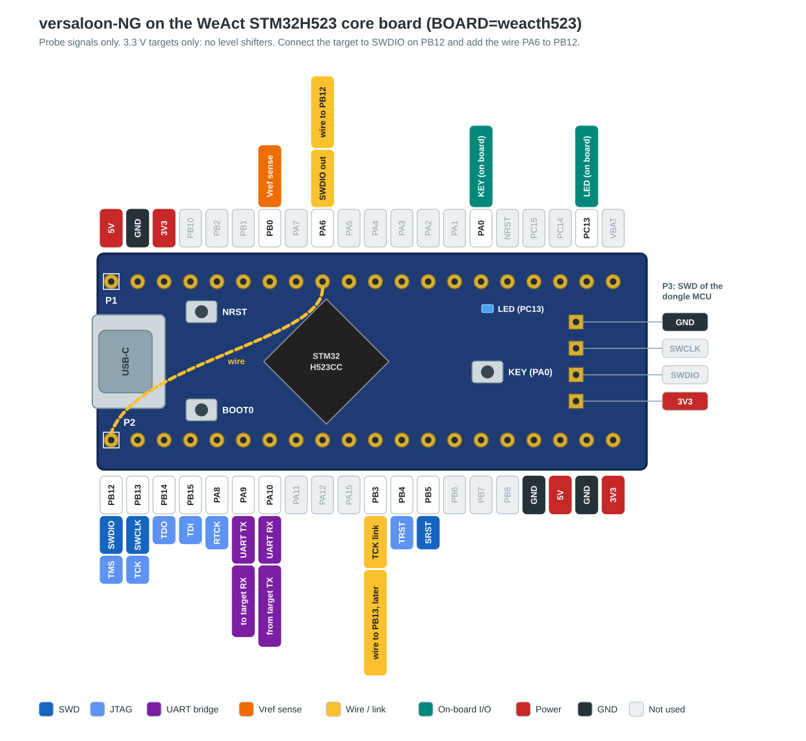

# Boards

This document describes the board support of the firmware: the board definitions, the start-up and the LEDs.
The README lists the supported boards.

## MCU family

The board selects the MCU family of the dongle.
The firmware knows two families: STM32F1 and STM32H5.
The Mini, the OtherUse and the ST-Link/V2 use an STM32F103x8 or STM32F103xB (family STM32F1).
CMSIS has one device define (`STM32F103xB`) for both parts.
The WeAct STM32H523 core board uses an STM32H523CC (family STM32H5, see [WeAct STM32H523 core board](#weact-stm32h523-core-board)).

`cmake/Boards.cmake` has one line for each board, with these values:

| Value | Use |
|---|---|
| Family | `STM32_FAMILY` of system-stm32. The toolchain file `cmake/gcc_arm.cmake` sets the CPU flags from it. |
| Device | `STM32_DEVICE` of system-stm32, the CMSIS device define. |
| Crystal | `SYSTEM_STM32_HSE_VALUE` of system-stm32, in Hz. 0 is a board without a crystal. |
| Linker script | The memory linker script in `ldscripts/`, for example `mem-f103.ld`. |
| Flash | The flash size in bytes. The size limit of each application image comes from it. The STM32F1 boards use 64 KB, the flash of the STM32F103x8. |

`CMakeLists.txt` reads `cmake/Boards.cmake` before `project()`.
The toolchain file needs `STM32_FAMILY` before the compiler checks start.
`cmake/gcc_arm.cmake` has CPU flags for the STM32F1 (Cortex-M3) and the STM32H5 (Cortex-M33).
Both families use soft float, as system-stm32 and libart-stm32.

## Board definitions

Each board has one `constexpr` board definition in `src/board/boards/`.
The board definition holds all board-specific data:

- The pin map: JTAG and SWD, UART, Vref sense, power switch, LEDs, key and USB pull-up.
- The MCU family.
- The crystal frequency. The value 0 is a board without a crystal. Only an STM32H5 board can have no crystal: its USB clock comes from the HSI48 and the clock recovery system (CRS).
- The JTAG fast path (SPI and DMA, see [JTAG fast path](usb-device.md#jtag-fast-path)). It is only available when the board links TCK (PB13) to PB3.
- The hardware ID that `VERSALOON_GET_HARDWARE` returns.

`src/board/BoardDefinition.h` defines the types. It does not use CMSIS, so the host unit tests check all boards.
CMake defines `VSL_BOARD_<BOARD>` (for example `VSL_BOARD_MINI`), and `src/board/Board.h` selects `board::current` from it.
The protocol and the engines read board data only through `board::current`.
`src/board/BoardPins.h` maps a board pin to the system-stm32 `GpioPin` and `FastPin` drivers.

The family and the crystal share one 32-bit word.
Thus a board definition stays 68 bytes, the same size as before the family field.
The firmware keeps the definition of the board in the flash.

Some functions come from the pin map and the family, not from a separate field:

- `board::adcChannelOf()` gives the ADC channel of the Vref pin.
  The channels of the STM32F103 come from RM0008. The channels of the STM32H523/H533 come from DS14539.
- `board::oneWireTimerOf()` gives the timer of the one-wire engine (WCH-Link) on the SWDIO output pin.
  On the STM32H5, only PA6 (TIM3_CH1) has a timer.
- `board::reservedPins()` gives the pins that no signal can use: USB D- and D+ (PA11, PA12) and the crystal pins.
  The crystal pins are PD0 and PD1 on the STM32F103, and PH0 and PH1 on the STM32H5.
- `board::swjConfig()` gives the debug port (SWJ) setting of the dongle MCU.
  The setting frees all debug port pins that the board uses, and keeps the rest.
  The Mini and the OtherUse use PA14 for an LED, so they disable the debug port.
  The ST-Link/V2 keeps JTAG and SWD.
  The debug port pins are the same on the two families.
  The STM32F103 frees the pins with `AFIO_MAPR.SWJ_CFG`.
  The STM32H5 has no AFIO. Its debug port pins are in AF0 after reset, and the GPIO mode of a pin frees the pin.
- `board::withSwd()` gives the board of a debug build with `VSL_DEBUG_SWD`.
  It removes the LEDs on the SWD pins (PA13, PA14), so the debug port keeps SWD.
  On the Mini and the OtherUse, the USB LED (PA14) is then not available.

The build fails when a board definition is not valid.
Examples are a pin that is used two times, or a crystal that is different from `SYSTEM_STM32_HSE_VALUE`.
The build also fails when the family of the board definition is different from `STM32_FAMILY`.
The JTAG fast path has fixed pins. TMS is on SPI1 MISO: PB4 on the STM32F103, PA6 on the STM32H5.
PB4 can also be SPI1 MISO on the STM32H5. The pin map of the H5 boards uses PB4 for TRST, so the firmware uses PA6.
The crystal range is 4 MHz to 16 MHz on the STM32F103, and 4 MHz to 50 MHz on the STM32H5.

To add a board:

1. Add a header with the board definition in `src/board/boards/`.
2. Add the board to `src/board/Board.h`.
3. Add the board to `VSL_BOARDS` in `cmake/Boards.cmake`, with its family, device, crystal and linker script.
   A new family also needs CPU flags in `cmake/gcc_arm.cmake`.
4. Add a build job to `.gitlab-ci.yml` and a test to `tests/TestBoards.cpp`.

## Start-up and LEDs

The system-stm32 start-up code calls `os_startup_initialize_hardware()` (`src/initialize_hardware.cpp`) before `main()`.
This function does these steps:

1. It sets the system clock from the board crystal, and the SysTick to 1 ms.
   The STM32F1 runs at 72 MHz.
   The STM32H5 runs at 250 MHz, with the instruction cache on.
2. It sets the debug port (SWJ) of the dongle MCU from `board::swjConfig()`.
   The Mini and the OtherUse disable the debug port. A debug probe can then connect only under reset.
   With `VSL_DEBUG_SWD` (default in a `Debug` build), SWD stays on and JTAG is off.
   Then a debug probe can run and step the firmware.
3. It puts the board pins into a safe state:
   - All LEDs are off, but the power LED is on. The main loop then drives the LEDs (see below).
   - The USB pull-up is off, so the host does not see the device.
   - The target power is off (the switch pin floats).
   - The key pin has a pull resistor to the released level.

The JTAG, SWD, UART and Vref pins stay inputs until their drivers configure them.

`main()` starts the USB device when the clock comes from the crystal (see [USB device](usb-device.md)).
The STM32F1 gets the USB clock from the PLL.
The STM32H5 gets the USB clock from the HSI48, and the clock recovery system (CRS) trims it from the USB start-of-frame packets.
The main loop runs the USB device and the UART bridge. It also drives the LEDs.
A `wch-link` image has no serial port and no UART bridge (see [WCH-Link personality](wch-link.md)).

| LED | Meaning |
|---|---|
| Power | On when the Vref pin has a voltage above 1.8 V. Off when the voltage is below 1.5 V. The dongle measures the voltage each 100 ms. |
| State | Off when the dongle is idle. One flash of 40 ms for each command of the host (Versaloon, CMSIS-DAP or WCH-Link). |
| USB | On when the host has configured the USB device. |

The power LED shows the target voltage, from the target supply or from the dongle supply.
A board without a working Vref sense keeps the power LED on all the time. This includes a board where the ADC calibration failed.
The dongle has no idle indication of the firmware. An idle dongle with no target and no USB host has all LEDs off. A hung main loop shows the same.
A continuous command stream gives a steady flicker on the state LED, because the LED stays off for at least 40 ms after each flash.

Three fault and event patterns replace the normal function:

| LED | Pattern | Meaning |
|---|---|---|
| State | Double flash: two flashes of 60 ms, each 600 ms | A JTAG or SWD transfer failed. The pattern starts at the first error and stops 2 s after the last error. Each new error restarts the 2 s. During the pattern, the state LED does not show the command activity. |
| State | Fast flash, five times each second | The crystal or the PLL did not start. The clock is HSI (8 MHz) and USB cannot work. The power LED still shows the target voltage. |
| All | Three flashes in 0.6 s, then on | The key has been down for 3 s: the dongle switches the personality of a multi image. After the flashes, all LEDs stay on until you release the key. The dongle then resets. |

A probe error is a transfer that ends with a FAULT acknowledge, no acknowledge, a parity error, or a WAIT acknowledge after all retries.
In the CMSIS-DAP personality, these are the transfers of `DAP_Transfer` and `DAP_TransferBlock`, on SWD and on JTAG.
A JTAG-DP has one acknowledge value for OK and FAULT.
A fault on JTAG only sets the STICKYERR bit in CTRL/STAT, and the dongle does not read this bit.
Thus on JTAG, only these errors count: a WAIT after all retries, an acknowledge that is not valid, and a failed scan.
A WAIT that `DAP_TransferAbort` stops and a value mismatch are not probe errors.
In the Versaloon personality, these are the failed `IN_OUT` transfers of the `SWD` block.
The `JTAG_RAW` block has no acknowledge, so the Versaloon personality does not show JTAG errors.
A host can cause probe errors in normal operation, for example when it scans for access ports that are not there.
Thus a short double flash at the connection is not always a problem.
The WCH-Link personality counts no probe errors, so it never shows the double flash.

The reset of the switch waits until the key is up for 50 ms, because a key that is down at the reset starts the bootloader.
The bootloader (versaloon-bootloader) keeps its own LED patterns, and the patterns of this firmware do not change them.
A build with `VSL_DEBUG_SWD` has no USB LED on the Mini and the OtherUse.

## WeAct STM32H523 core board

The board `weacth523` is the WeAct Studio STM32H523 core board V1.0, in the "Black Pill" form.
It has an STM32H523CCU6 or an STM32H523CCT6, and an 8 MHz crystal.
The STM32H523CC has 256 KB flash in two banks of 128 KB.
The schematics are in the WeAct repository [WeActStudio.STM32H523CoreBoard](https://github.com/WeActStudio/WeActStudio.STM32H523CoreBoard), in `Hardware/`.

The pin map follows the board and its headers:

- The state LED is the on-board LED (PC13, active low).
- The key is the on-board KEY button (PA0, active low).
- RTCK is PA8, because PA0 is the key.
- SWDIO in is PB12, on the header pin next to SWCLK.
- SRST is PB5. Thus all target signals except Vref are on header P2.

The board has no level shifters and no target power switch.
Connect only targets with a 3.3 V supply.
The board and the target must have a common ground.

The firmware on the board has these limits:

- The personalities Versaloon, CMSIS-DAP and WCH-Link, alone or in a multi image. A multi image keeps the last 8 KB flash sector of bank 2 for the stored personality (see [Multi image](usb-device.md#multi-image)).
- A one-wire target (WCH-Link, CH32V00x) needs an external pull-up of 2.2 kΩ from SWDIO to 3.3 V. The internal pull-ups are too slow for the read bits (see [One-wire timer](wch-link.md#one-wire-timer)).
- Only the `standalone` image at `0x08000000`. `VERSALOON_FW_UPDATE`, the bootloader code `0xB0` and the key at the reset start the ROM USB DFU (see [STM32H5: ROM USB DFU](firmware-update.md#stm32h5-rom-usb-dfu)).
- The JTAG fast path needs a wire from PB13 to PB3 (see [Wiring to the target](#wiring-to-the-target)).
- The UART bridge supports 3815 baud to 15.6 Mbaud. USART1 runs from the 250 MHz bus clock, and the firmware does not use the USART prescaler. The bridge refuses a lower baud rate, for example 2400 baud.

PC13 is in the backup domain.
It can sink only 3 mA, and its speed is low.
Thus PC13 is good for the LED, but do not use it for a target signal.

### Wiring to the target



| Signal | Pin | Header | Note |
|---|---|---|---|
| TMS, SWDIO (input) | PB12 | P2 pin 1 | Connect the target here. For a one-wire target, add a 2.2 kΩ pull-up to 3.3 V. |
| TCK, SWCLK | PB13 | P2 pin 2 | |
| TDO | PB14 | P2 pin 3 | |
| TDI | PB15 | P2 pin 4 | |
| RTCK | PA8 | P2 pin 5 | Optional |
| UART TX (to target RX) | PA9 | P2 pin 6 | USART1 of the serial bridge |
| UART RX (from target TX) | PA10 | P2 pin 7 | |
| TRST | PB4 | P2 pin 12 | Optional. See [Hardware test](#hardware-test) for JTAG after SWD. |
| TCK link | PB3 | P2 pin 11 | For the JTAG fast path: connect a wire from PB13 (P2 pin 2) to PB3. Do not connect the target. |
| SRST | PB5 | P2 pin 13 | |
| GND | GND | P2 pin 17 or 19 | |
| TMS, SWDIO (output) | PA6 | P1 pin 9 | Connect a wire from PA6 to PB12 (P2 pin 1). |
| Vref sense | PB0 | P1 pin 7 | Optional. Connect the target supply, 3.3 V maximum. No divider. |

The last four pins of P2 are GND, 5 V, GND and 3.3 V (pins 17 to 20).
Without the wire from PB13 to PB3, JTAG fails at the speeds of the fast path (see [JTAG fast path](usb-device.md#jtag-fast-path)).
P2 pin 8 is PA11 (USB D-). Do not connect the TCK link there.

The board has these other signals:

| Signal | Pin | Note |
|---|---|---|
| State LED | PC13 | Blue LED, active low. The board has no power LED and no USB LED. |
| Key | PA0 | KEY button, active low. The firmware sets the pull-up of the pin. |
| USB | PA11, PA12 | USB Type-C connector. The D+ pull-up is in the STM32H5. |
| SWD of the dongle MCU | PA13, PA14 | SWD header P3: SWDIO on pin 2, SWCLK on pin 3. The firmware does not use these pins. |

Without a Vref connection, the Vref value of the Versaloon personality is not valid.

### Flash the firmware

The board has no on-board debug probe.
Use the USB DFU (Device Firmware Upgrade) bootloader in the system memory of the STM32H5.
To write the firmware, do these steps:

1. Hold the BOOT0 button down.
2. Push and release the NRST button.
3. Release the BOOT0 button. The board shows as the USB device `0483:df11`.
4. Write the `standalone` image with `dfu-util`:

   ```sh
   dfu-util -d 0483:df11 -a 0 -s 0x08000000:leave -D versaloon-ng-standalone.bin
   ```

5. Disconnect the board and connect it again. The firmware starts.

The `:leave` request does not start the firmware on this board, so step 5 is necessary.
After the `:leave` request, `dfu-util` can show `Error during download get_status`.
This message has no effect: the write is complete.

A debug probe on the SWD header P3 can also write the `standalone` image at `0x08000000`.

### Hardware test

`tools/probe_hw_test.py` tests the dual image on an STM32F1 target (see [Multi image hardware test](usb-device.md#multi-image-hardware-test)).
Connect TMS, TCK, TDI, TDO, TRST, SRST and GND to the JTAG connector of the target.
Connect the wire from PA6 to PB12, and the wire from PB13 to PB3.
Connect PA9 to PA10 for the UART loopback.

The script runs SWD before JTAG with each tool.
The first run had no TRST and no SRST wire.
All SWD steps passed, and all JTAG steps failed with `JTAG scan chain interrogation failed: all ones`.
The TDI and TDO wires were correct: a GPIO test checked them.
After the SWD-to-JTAG switch sequence, OpenOCD found the two TAPs of the target on JTAG.
With TRST and SRST wired, all JTAG steps passed.
The test did not show which of the two signals is necessary.

Status: the test passed on 2026-10-25 (work item #95).
Probe: WeAct STM32H523 core board.
Image: `weacth523-dual` preset (`VSL_PERSONALITIES=versaloon,cmsis-dap`), `Release` build, `v0.12.0-19-gdb50fde`, `standalone` image.
Target: STM32F103ZE (device ID `0x414`, 512 KiB flash).
Host: Linux, OpenOCD 0.12.0+dev-01355-gcba596a3e, pyOCD 0.45.1, probe-rs 0.32.0.

| Check | Versaloon | CMSIS-DAP |
|---|---|---|
| Switch with the switch request on EP0 | pass | pass |
| Switch with the key (3 s), also after a reset of the board | pass | pass |
| Serial loopback, quick set (3 baud rates, 8N and 8E, 1 and 2 stop bits) | pass | pass |
| `DAP_UART_*` loopback | - | pass |
| OpenOCD SWD, 1000 and 2000 kHz | pass | pass |
| OpenOCD JTAG, 1000 and 9000 kHz | pass | pass |
| pyOCD SWD, 1000 and 2000 kHz | - | pass |
| pyOCD JTAG, 1000 and 9000 kHz | - | pass |
| probe-rs SWD, 1000 and 2000 kHz | - | pass |
| probe-rs JTAG, 1000 kHz | - | pass |

Findings:

- One run of the script failed on OpenOCD JTAG with the `vsllink` driver.
  At 1000 kHz, the read back of the flash had 10 bytes with one wrong bit each. Each wrong bit was 0 in the image and 1 in the read back.
  The verify step calculates a CRC on the target, and it passed. Thus the error was in the read path, not in the flash.
  At 9000 kHz, the flash write stopped with `Invalid ACK (6) in DAP response`.
  This run came directly after a change to the wires.
  Five more runs of the script passed: two runs of the Versaloon steps, two runs of the Versaloon and UART steps, and one full run.
  Three more read backs of the 32 KiB image with OpenOCD and the `vsllink` driver on JTAG at 1000 kHz had no errors.
  The cause is not known. The timing of the bit-bang engines at 250 MHz is not yet measured (#94).
- The test did not cover `--full-uart`, the old switch commands, the WCH-Link personality, Windows and a target with a supply other than 3.3 V.
