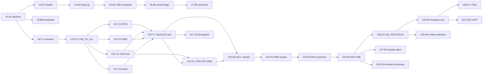

# vsl-ng firmware plan

This document is the plan for the Versaloon next generation firmware (vsl-ng).
The GitLab issues of this project hold the details of each work item.
This document gives the overview: targets, phases, milestones and dependencies.
When an issue and this document do not agree, the issue is correct. Update this document then.

## Targets

- **Versaloon Mini** and **OtherUse**: STM32F103C8 or STM32F103CB, 12 MHz crystal, 72 MHz core clock.
- **ST-Link/V2** clone: STM32F103C8, 8 MHz crystal. It is a compile-only target.
  It is not a supported board now, but a port must be easy.

The firmware runs behind `versaloon-bootloader`.
The legacy bootloader uses the first 10 KB of flash, so the application starts at `0x08002800`.
The new `versaloon-bootloader` uses 8 KB, so the application starts at `0x08002000`.
The OtherUse has an STM32F103C8 (64 KB flash), so the application must not be larger than 54 KB: it must also fit behind the legacy bootloader.

The firmware is compatible with the original Versaloon USB protocol.
Unmodified upstream OpenOCD (`interface/vsllink.cfg`) must work with it.
The dongle also has a USB-CDC serial port, which is bridged to USART1.

## Building blocks

| Component | Repository | Use |
|---|---|---|
| system-stm32 | `embedded-libraries/system-stm32` | Start-up code, CMSIS, peripheral drivers (GPIO, USART, ADC, USB device) |
| libArT | `embedded-libraries/libArT` | Core library: streams, logging, USB device stack |
| libart-stm32 | `embedded-libraries/libart-stm32` | STM32 adapters for libArT (serial, USB controller) |

The three libraries are Git submodules in `dependencies/`.
The build system and the CI follow the [universal oven controller firmware](https://gitlab.vandertogt.org/ht-oven/universal-oven-controller-firmware).

## Phases and milestones

| Phase | Milestone | Result |
|---|---|---|
| A: platform | M1 | system-stm32 supports STM32F1 |
| B: serial | M1: USB-serial adapter | The dongle starts from the bootloader and enumerates as Versaloon plus a COM port. The serial bridge works at all line codings. |
| C: OpenOCD | M2: OpenOCD works | OpenOCD programs and debugs targets over JTAG and SWD |
| D: release | M3: Release | Fast JTAG through SPI and DMA, throughput tuning, documentation and release builds |
| E: CMSIS-DAP | M4: CMSIS-DAP probe | A second USB personality, CMSIS-DAP v2, for OpenOCD, pyOCD and probe-rs. Build-time selection first, runtime selection later. |

## Work items

The estimates are in person-days (low-high).

| Issue | Work item | Estimate | Depends on |
|---|---|---|---|
| #1 | A0: STM32F1 support in system-stm32 (tracking issue) | 9.75-17.75 | system-stm32#9 to system-stm32#16 |
| #2 | B1: Project skeleton: CMake, submodules, CI, linker scripts | 1.5-2 | system-stm32#9 |
| #3 | B7: Board abstraction (Mini, OtherUse, compile-only ST-Link/V2) | 1-1.5 | #2 |
| #4 | B2: Board bring-up: clocks, LEDs, logger, heartbeat | 0.5-1.5 | #3, system-stm32#10, system-stm32#11 |
| #5 | B3: USB composite device: Versaloon vendor interface and CDC-ACM | 1-2 | #4, system-stm32#15, libart#49 |
| #6 | B5: USB-CDC to UART bridge | 1.5-3 | #5, system-stm32#12, libart#49 |
| #7 | B6: Serial port test script | 0.5-1 | #6 |
| #8 | B8: Bootloader integration and `FW_UPDATE` entry | 1-1.5 | #2, system-stm32#10 |
| #9 | C1: Versaloon command transport and basic commands | 1.5-2 | #2, libart#49 |
| #10 | C2: `USB_TO_ALL` dispatcher, `INFO` and `DELAY` | 1.5-2.5 | #9 |
| #11 | C3: `USB_TO_GPIO` block (reset lines) | 0.5-1 | #10, system-stm32#11 |
| #12 | C4: JTAG raw engine (bit-bang) | 1.5-2.5 | #10, system-stm32#14 |
| #13 | C5: SWD engine | 2-3.5 | #10, system-stm32#14 |
| #14 | C6: Target power control and Vref sense | 0.5-1 | #10, system-stm32#13 |
| #15 | C7: OpenOCD integration test | 2.5-5 | #11, #12, #13, #14 |
| #16 | D1: JTAG fast path with SPI and DMA | 2.5-4 | #12, #15 |
| #17 | D2: USB and protocol throughput tuning | 1-2 | #15 |
| #18 | D3: Documentation and release builds | 1-1.5 | #15, #16 |
| #22 | E1: Make the SWD engine configurable for CMSIS-DAP | 1.5-2.5 | #16, #17, #18 |
| #23 | E2: CMSIS-DAP command processor (SWD, phase 1 commands) | 3-5 | #22 |
| #24 | E3: CMSIS-DAP USB function and descriptors | 1.5-2.5 | #23 |
| #25 | E4: Build-time personality option `VSL_PROTOCOL` | 1-1.5 | #24 |
| #26 | E5: CMSIS-DAP hardware test with OpenOCD, pyOCD and probe-rs | 1.5-3 | #25 |
| #27 | E6: `DAP_TransferAbort` during a running command | 0.5-1.5 | #24 |
| #28 | E7: CMSIS-DAP JTAG commands and JTAG DAP transfers | 2.5-4 | #26 |
| #29 | E8: Runtime selection of the USB personality | 2-3 | #25 |
| #30 | E9: Driverless Windows: BOS and MS OS 2.0 descriptors | 1.5-2.5 | #24 |
| #31 | E10: CMSIS-DAP UART commands (`DAP_UART_*`) | 1-2 | #26 |

## Dependencies

The diagram shows the dependencies between the work items of this project.
Some work items depend on single system-stm32 issues. The table lists them. #1 tracks all of them.

## Hardware tests

Issues with the label `needs-hardware` need a Versaloon Mini or an OtherUse for the acceptance test.
Do the software part first and verify it with the build and the host unit tests.
Then record the open hardware test in the issue.
