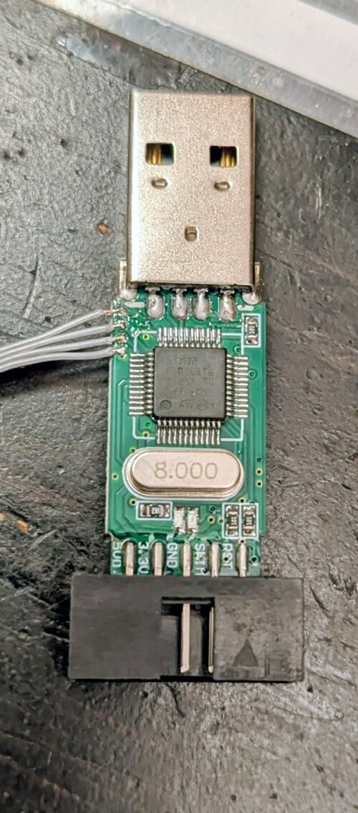
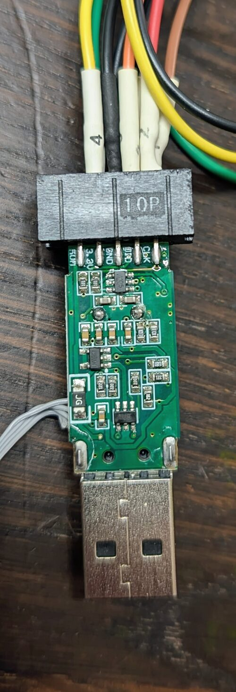

# ST-Link/V2 mini clone

The board `stlinkv2miniclone` is a USB stick debug probe.
Shops sell it as "ST-Link V2 mini".
It is a clone, not the official ST-Link/V2 design (board `stlinkv2`).
The board has no markings.

This document gives the pin map of the board, and how we measured it.

| Top side | Bottom side |
|---|---|
|  |  |

The top side has the MCU, the 8 MHz crystal and the two LEDs.
The four wires on the top side go to the SWD pads of the MCU (see [SWD pads of the MCU](#swd-pads-of-the-mcu)).

Status: the pin map is measured, and the firmware runs on the board (see [Hardware test](#hardware-test)).

## MCU

The MCU is in a 48-pin package with the ST logo and the text "STM32".
The rest of the text is not readable.
The MCU is not a genuine STM32F103.
It is a compatible MCU of an unknown manufacturer.
We read these values with SWD:

| Value | Read | Genuine STM32F103 |
|---|---|---|
| DPIDR | `0x1BA01477` | The same |
| `DBGMCU_IDCODE` | `0x20030410` (medium density, revision X) | The same |
| CPUID | `0x412FC230` (Cortex-M3 r2p0) | `0x411FC231` (r1p1) |
| Flash size register | 128 KB | 64 KB or 128 KB |
| Flash | 128 KB: a write and erase of the page at `0x0801FC00` does not change `0x0800FC00`, and a read at `0x08020000` gives a bus error | 64 KB or 128 KB |
| SRAM | 96 KB or more: 4 test words to `0x20017FF0` keep different values | 20 KB |
| Unique ID (`0x1FFFF7E8`) | All zeros | A unique value |
| Boot alias of an empty flash | `0x1FFFB000` | The flash, or the system memory at `0x1FFFF000` (BOOT0 high) |

The firmware uses only 64 KB flash and 20 KB SRAM (see [MCU family](boards.md#mcu-family)).
The USB and GPIO peripherals work with the STM32F103 drivers (see [Hardware test](#hardware-test)).
The test did not check the ADC (Vref sense) and the timers (WCH-Link one-wire) of the firmware.

The unique ID is zero, so the USB serial number is `000000000000000000000000`.
Two of these probes on one host have the same serial number.

The crystal is 8 MHz.

## Header

The header has 2 rows of 5 pins.
The text on the board names the pins: one row on each side of the board.
The triangle on the header connector marks pin 1, at the RST end.

| Pin | Signal | MCU pins | Pin | Signal | MCU pins |
|---|---|---|---|---|---|
| 1 | RST | PB6, PB5 | 2 | SWCLK (CLK) | PA5, PB13 |
| 3 | SWIM | PB7 to PB11 | 4 | SWDIO (DIO) | PB14, PB12 |
| 5 | GND | | 6 | GND | |
| 7 | 3.3V | | 8 | 3.3V | |
| 9 | 5V | | 10 | 5V | |

The pin numbers come from the position of the triangle.
We did not measure them: we measured the signal of each labelled pin.

The board connects 2 or more MCU pins to each signal pin of the header.
The firmware drives one MCU pin of each signal:

| Signal | Pin of the firmware | Other MCU pins | Board definition field |
|---|---|---|---|
| SWCLK, TCK | PA5 | PB13 | `debug.tck` |
| SWDIO, TMS | PB14 (output), PB12 (input) | - | `debug.tmsOut` (PB14), `debug.tmsIn` (PB12) |
| RST (target reset) | PB6 | PB5 | `debug.srst` |
| SWIM | - | PB7 to PB11 | not used |

The other MCU pins stay floating inputs after the reset.
Do not set them to output: they connect to the pin that the firmware drives.

SWDIO uses two MCU pins, as on the Versaloon Mini.
PB14 is the output. It has the timer output of the WCH-Link one-wire engine (TIM1_CH2N).
PB12 is the input, with the internal pull-up on.
The pull-up holds an open SWDIO line high.
Thus SWD without a target reads the acknowledge `0b111`, and the one-wire read bits have a pull-up (see [One-wire timer](wch-link.md#one-wire-timer)).
The SWIM pins have a pull-up on the board.
The firmware does not support SWIM (the STM8 debug protocol).

The 3.3V pins always supply power.
No GPIO switches them, so the board has no target power switch.
We did not measure the 5V pins.

## Signals that the header does not have

The board definition must give TDI, TDO and a UART.
These pins of the official ST-Link/V2 design are not connected on this board:

| Field | MCU pin | Result |
|---|---|---|
| `debug.tdi` | PA7 | Not connected. The board has no JTAG. Use SWD. |
| `debug.tdo` | PA6 | Not connected |
| `uart` | USART2, PA2 (TX) and PA3 (RX) | Not connected. The serial port of the USB-CDC bridge does not reach a target. |

## Other signals

| Signal | MCU pin | Note |
|---|---|---|
| LEDs | PA9 | Two LEDs on one pin. High: blue LED on. Low: red LED on. Digital input: the red LED glows a little. Analog mode: both LEDs are off. The firmware uses PA9 as a two-colour state LED: blue when idle, off for activity, red for a fault (see [Start-up and LEDs](boards.md#start-up-and-leds)). |
| Vref sense | PA0 | Divider 2 (1.648 V at VDDA 3.289 V). The divider reads the 3.3 V of the board. The header 3.3V pins are an output, so the probe cannot measure a target voltage. |
| USB | PA11, PA12 | The D+ pull-up is fixed. No GPIO switches it. |
| BOOT1 | PB2 | Resistor to GND |
| SWD of the MCU | PA13, PA14 | Pads on the top side, see [SWD pads of the MCU](#swd-pads-of-the-mcu) |

The board has no key and no power LED.

Other documents name the ST-Link/V2 for a board with a fixed USB pull-up, no key and no RTCK.
These statements also apply to this board.
The differences are the RST pin (PB6, not PB0), the SWDIO input pin (PB12), and the missing JTAG and UART pins on the header.

## SWD pads of the MCU

The top side has four pads on the long edge, next to the USB connector.
From the USB connector, the pads are:

1. VCC
2. SWDIO
3. SWCLK
4. GND

Connect a debug probe to these pads to write the firmware.

## Bootloader

The board runs the firmware behind `openmupp-bootloader` (board `stlinkv2miniclone` of the bootloader).
Then you can update the firmware over USB, without the SWD pads.
Write the combined image `versaloon-ng-with-bootloader.hex` one time with a debug probe on the SWD pads (see [Install the bootloader](firmware-update.md#install-the-bootloader)).
Remove the read protection first (see [Read protection of the original firmware](#read-protection-of-the-original-firmware)).

The bootloader starts in these conditions:

1. The firmware sends a boot request (see [Start the bootloader](firmware-update.md#start-the-bootloader)).
2. The application image is not valid.
3. SWIM is connected to GND at the start. This is the key of the board.

To start the bootloader with the key, do these steps:

1. Disconnect the board from USB.
2. Connect a wire from SWIM (header pin 3) to GND (header pin 5).
3. Connect the board to USB. The bootloader starts.
4. Remove the wire.

The key also works when the application is valid but does not run.
Thus a broken application does not need a debug probe.
The SWIM pins (PB7 to PB11) have a pull-up on the board, so the key is released when no wire is connected.
The firmware does not use the SWIM pin as a key.

## Read protection of the original firmware

The original firmware has read protection level 1.
A debugger cannot read the flash.
When a debugger connects, the original firmware stops with a lockup (PC `0xFFFFFFFE`).
On the STM32F1, read protection blocks flash access for the CPU when a debugger connects.

The debugger can still write the RCC, GPIO and ADC registers, and the SRAM.
Thus you can measure the pin map without an erase of the flash.

To remove the read protection, do a mass erase.
The mass erase deletes the original firmware.
We removed the read protection of the test board with these steps on 2026-10-26:

```sh
openocd -f interface/cmsis-dap.cfg -f target/stm32f1x.cfg -c "init; reset halt; stm32f1x unlock 0; exit"
```

Then disconnect the power of the board, and connect it again.

## Hardware test

Status: the test passed on 2026-10-26.
Image: `stlinkv2miniclone` board with `VSL_PERSONALITIES=versaloon,cmsis-dap,wch-link`, `Release` build.

The test used the `app-8k` image behind `openmupp-bootloader`, in the combined image `versaloon-ng-with-bootloader.hex`.
The `standalone` image has the same source code and clock setup, but nobody ran it on the board.

The image was written with SWD (OpenOCD `program`, with verify) through the SWD pads.

| Check | Result |
|---|---|
| Enumeration after the reset by the debugger (fixed D+ pull-up) | pass: `0483:a038` |
| Switch Versaloon → CMSIS-DAP → WCH-Link → Versaloon with the switch request on EP0 | pass: `0403:9b3c`, `1209:0001`, `0483:a038` |
| State LED, idle | pass: blue |
| State LED, commands and probe errors (OpenOCD `vsllink`, no target) | pass: blue off on each command, red double flashes |
| Write of the combined image with SWD after `stm32f1x unlock 0` | pass: verified |
| `vsl_personality.py switch bootloader` (boot request) | pass: `0483:5740` with the product `Bootloader` |
| `stm32flash -w versaloon-ng-app-8k.bin -v -S 0x08002000`, then `-g 0x08002000` | pass: write and verify, the firmware starts as `0483:a038` |
| Key: SWIM to GND at power-up, with a valid application | pass: `0483:5740` |
| Power-up without the SWIM wire | pass: the firmware starts |

### SWD test with a target

Status: the test passed on 2026-10-27.
Image: the same image as in [Hardware test](#hardware-test).
Target: STM32H523CC (Cortex-M33) on a WeAct core board, at 3.3 V.
The SWDIO, SWCLK and GND pins of the header were connected to the SWD pins of the target.
The RST pin was not used: each tool reset the target with `SYSRESETREQ`.

The test used SWD speeds of 1000, 2000, 4000, 8000 and 10000 kHz:

| Tool | Steps | Result |
|---|---|---|
| probe-rs, CMSIS-DAP personality | Write and verify 32 KB of flash (`0x08038000`), read it back, reset | pass at all speeds |
| pyOCD, CMSIS-DAP personality | Halt, write and read 16 KB of RAM, two single steps, hardware breakpoint, run and halt, reset | pass at all speeds |
| OpenOCD `cmsis-dap`, CMSIS-DAP personality | Halt, `load_image` and `verify_image` of 16 KB of RAM, two single steps, hardware breakpoint, run and halt, reset | pass at all speeds |
| OpenOCD `vsllink`, Versaloon personality | The same steps as OpenOCD `cmsis-dap` | pass at all speeds, with one failure at 4000 kHz in the first run (see below). Runs: 2 at 1000 and 2000 kHz, 11 at 4000 kHz, 6 at 8000 and 10000 kHz |

The RAM speed of pyOCD (write and read) was 61 KiB/s at 1000 kHz, 97 KiB/s at 2000 kHz and 137 KiB/s at 4000 kHz and more.
Thus above 4000 kHz, USB and not SWD sets the speed.

In the first run of OpenOCD `vsllink` at 4000 kHz, the single steps did not run the test loop in RAM.
After that, OpenOCD could not read the PC.
OpenOCD wrote "target was in unknown state when halt was requested" before the halt.
The run before it ended with a reset of the target, so the halt possibly came during the start of the target.
The failure did not occur again in 20 more runs at 4000, 8000 and 10000 kHz.

The board has no JTAG pins, so the test did not include JTAG.

## How we measured the pin map

A Versaloon probe (CMSIS-DAP personality) was connected to the SWD pads.
OpenOCD wrote the GPIO registers.
The CPU was in lockup, so the original firmware did not change the pins.
A logic analyser (Saleae Logic Pro 8) was connected to the header pins SWIM, RST, SWCLK, SWDIO and the two 3.3V pins.

We did these tests:

1. Pull test. All free GPIO pins were inputs with the internal pull-down, then with the internal pull-up. A pin that did not follow the internal pull has an external pull-up, an external pull-down or a driver.
2. Drive sweep. Each free GPIO pin in turn was an output, in a fixed sequence. The pin at position N in the sequence sent N + 1 pulses. Thus the pulse count on a header pin identifies the MCU pin. After each step, OpenOCD read all GPIO inputs. When two MCU pins show the same input change, the board connects them.
3. USB pull-up test. During the drive sweep, D+ (PA12) stayed high with the internal pull-down. Thus no GPIO controls the D+ pull-up.
4. ADC test. The ADC measured PA0 to PA7, PB0 and PB1. The internal reference (VREFINT) gave the scale.
5. LED test. PA9 was high, then low, then an input, and we looked at the LEDs.

The test did not include PA11 to PA14: these pins are USB and SWD.
